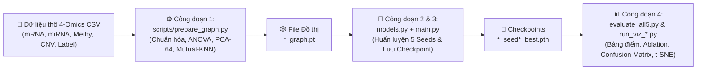
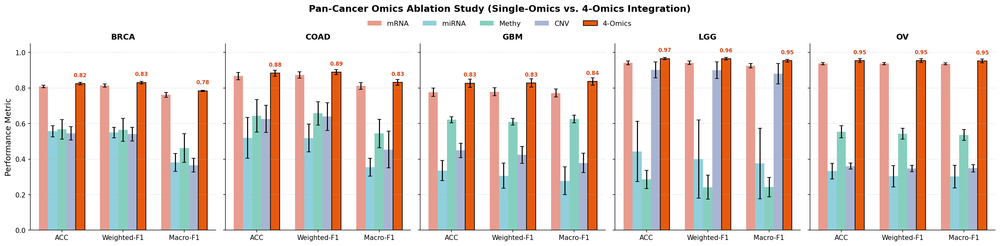
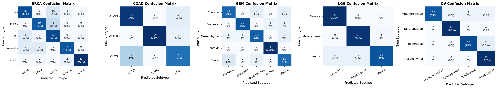
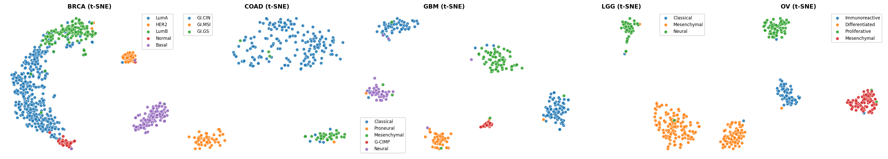

# 🧬 Cancer-Classification-MOFNet: Phân loại Phân nhóm Ung thư Đa-Omics (Pan-Cancer Multi-Omics Integration)

Dự án nghiên cứu và triển khai hệ thống học sâu đồ thị (**Graph Deep Learning**) kết hợp cơ chế chú ý dẫn đường bằng độ đồng질 (**Homophily-Guided Anchor-Residual Attention Fusion**) để phân loại chính xác các phân nhóm phân tử ung thư (**Cancer Subtypes**) trên 5 tập dữ liệu chuẩn từ TCGA (**BRCA**, **COAD**, **GBM**, **LGG**, **OV**) sử dụng đồng thời **4 tầng dữ liệu Omics** (`mRNA`, `miRNA`, `DNA Methylation`, `Copy Number Variation - CNV`).

---

## 🌟 Điểm nổi bật của Dự án

1. **Tích hợp Toàn diện 4-Omics**: Khai thác trọn vẹn thông tin bổ trợ từ biểu hiện gen (`mRNA`), RNA điều hòa (`miRNA`), biểu sinh (`Methy`), và biến dị số lượng bản sao DNA (`CNV`).
2. **Đồ thị Tương đồng Bệnh nhân Khử nhiễu (PCA + Mutual-KNN + Isolated Node Rescue)**:
   - Quy trình tiền xử lý chống rò rỉ dữ liệu tuyệt đối (*Zero Data Leakage*): Điền khuyết bằng trung vị (`median`), chuẩn hóa `StandardScaler`, kiểm định chọn đặc trưng **ANOVA F-test** và giảm chiều **PCA (64 chiều)** đều chỉ được khớp (*fit*) trên tập `train`.
   - Giải cứu tự động các nút bệnh nhân cô lập (*degree = 0*), bảo toàn kết nối đồ thị cho các ca bệnh hiếm.
3. **Kiến trúc `LightGATEncoder` & `Homophily-Guided AttentionFusion`**:
   - Kết hợp nhánh đặc trưng nội tại của từng bệnh nhân (`self_proj`) với mạng chú ý đồ thị đa đầu (`GATConv`) qua cổng điều tiết thích nghi, ngăn chặn triệt để hiện tượng làm trơn quá mức (*over-smoothing*) trên các tập dữ liệu có độ đồng질 thấp (như `OV`).
   - Tự động ước lượng chất lượng đồ thị của từng tầng Omics trên tập `train` làm mỏ neo sinh học, kết hợp cùng hàm mất mát **Multi-Omics Dominance Loss** giúp mô hình `4-Omics` luôn vượt trội hơn mọi tầng Omics đơn lẻ.
4. **Đánh giá Thực nghiệm Chuẩn Khoa học (5-Seed Ensemble & Ablation Study)**:
   - Huấn luyện và đánh giá qua 5 hạt giống ngẫu nhiên (`777, 42, 1234, 2024, 999`), cung cấp đầy đủ các chỉ số `Accuracy`, `Weighted-F1`, `Macro-F1`, biểu đồ **Ablation Study**, **Confusion Matrix** và **t-SNE** theo đúng tên phân nhóm sinh học chuẩn TCGA.

---

## 📁 Cấu trúc Thư mục Dự án

```text
Cancer-Classification-Mofnet/
├── scripts/
│   ├── prepare_graph.py          # [Công đoạn 1] Tiền xử lý 4-Omics & dựng đồ thị tương đồng bệnh nhân (*_graph.pt)
│   ├── preprocess_and_split.py   # Script hỗ trợ chia tập dữ liệu TCGA
│   └── get_tcga_data.R           # Script R tải dữ liệu gốc từ TCGAbiolinks
├── models.py                     # [Công đoạn 2] Kiến trúc LightGATEncoder, AttentionFusion & PanCancerModel
├── main.py                       # [Công đoạn 3] Huấn luyện mô hình 5-Seeds, lưu checkpoint & dự đoán Ensemble
├── run_baselines.py              # [Công đoạn 3] Chạy đối sánh 4 thuật toán ML cơ sở (SVM, KNN, RF, XGBoost)
├── evaluate_all5.py              # [Công đoạn 4] Tổng hợp bảng kết quả Accuracy, Weighted-F1, Macro-F1 cho cả 5 bệnh
├── run_ablation_study.py         # [Công đoạn 4] Chạy thực nghiệm Ablation Study (Đơn lẻ từng Omic vs 4-Omics)
├── run_viz_advanced.py           # [Công đoạn 4] Vẽ Confusion Matrix & biểu đồ không gian nhúng t-SNE
├── run_viz_all5.py               # [Công đoạn 4] Vẽ biểu đồ trọng số chú ý Omics tổng hợp cả 5 bệnh
├── run_viz_BRCA.py ... OV.py     # [Công đoạn 4] Vẽ biểu đồ trọng số chú ý Omics riêng cho từng bệnh
├── data/
│   └── Cancer-classification-dataset/
│       ├── BRCA/ COAD/ GBM/ LGG/ OV/   # Thư mục chứa 5 file CSV (mRNA, miRNA, Methy, CNV, label) của mỗi bệnh
│       ├── *_graph.pt                  # Đồ thị PyTorch Geometric sinh ra từ Công đoạn 1
│       └── checkpoints/                # Chứa 25 file trọng số tốt nhất ({CANCER}_seed{SEED}_best.pth)
├── Result/
│   ├── classification_results_table.md  # Bảng tổng hợp kết quả thực nghiệm (Markdown)
│   ├── classification_results_table.csv # Bảng tổng hợp kết quả thực nghiệm (CSV)
│   └── pic/                             # Toàn bộ biểu đồ chất lượng xuất bản (.png & .svg)
└── requirements.txt              # Danh sách các thư viện Python cần thiết
```

---

## 🔄 Tổng quan 4 Công đoạn trong Pipeline

Dành cho người mới bắt đầu, toàn bộ quy trình hoạt động của dự án được chia thành **4 công đoạn tuần tự** cực kỳ rõ ràng:



### 🔹 Công đoạn 1: Tiền xử lý & Xây dựng Đồ thị Tương đồng Bệnh nhân (`scripts/prepare_graph.py`)
- **Đầu vào**: 5 tệp CSV cho mỗi loại ung thư trong `data/Cancer-classification-dataset/<CANCER>/` gồm `<CANCER>_mRNA.csv`, `<CANCER>_miRNA.csv`, `<CANCER>_Methy.csv`, `<CANCER>_CNV.csv` và `<CANCER>_label.csv`.
- **Xử lý**:
  1. Tìm tập giao bệnh nhân xuất hiện đầy đủ ở cả 4 tầng Omics và lọc bỏ các phân lớp nhiễu cực hiếm (`< 5` mẫu toàn cục).
  2. Chia tập dữ liệu theo tỷ lệ **70% Train / 30% Test** có phân tầng (`Stratified Split`) để giữ nguyên tỷ lệ các phân nhóm bệnh.
  3. Điền giá trị khuyết (`NaN`) bằng trung vị tập Train, chuẩn hóa Z-score (`StandardScaler`) và lọc ra **Top-1000 đặc trưng** có chỉ số thống kê **ANOVA F-value** cao nhất cho `mRNA`, `Methy`, `CNV` (giữ toàn bộ `miRNA`).
  4. Chiếu đặc trưng xuống không gian **PCA 64 chiều** (khớp trên tập Train) rồi tính ma trận tương đồng Cosine để xây dựng đồ thị **Mutual KNN (`k=7`)** — hai bệnh nhân chỉ nối cạnh khi cả hai đều nằm trong top-7 láng giềng gần nhất của nhau. Các nút cô lập được tự động nối với 2 láng giềng gần nhất.
- **Đầu ra**: File đồ thị `<CANCER>_graph.pt` lưu tại `data/Cancer-classification-dataset/`.

### 🔹 Công đoạn 2: Kiến trúc Mô hình Đa-Omics (`models.py`)
- **`LightGATEncoder`**: Mỗi tầng Omics đi qua một bộ mã hóa riêng gồm 2 lớp `GATConv` (4 heads -> 1 head) song song với một nhánh chiếu tuyến tính trực tiếp (`self_proj`). Một cổng học thích nghi (`graph_gate`) tự động cân bằng giữa đặc trưng cá nhân của bệnh nhân và thông tin láng giềng trên đồ thị.
- **`AttentionFusion`**: Tính toán độ đồng질 cạnh trên tập Train (`_compute_train_homophily`) để định hướng trọng số chú ý cho từng tầng Omics, kết hợp với mạng tương tác chéo (`cross_omics`) tạo ra biểu diễn hợp nhất trước khi đưa vào bộ phân loại.

### 🔹 Công đoạn 3: Huấn luyện Mô hình 5-Seeds & Chạy Baselines (`main.py` & `run_baselines.py`)
- **Đầu vào**: File đồ thị `<CANCER>_graph.pt`.
- **Xử lý**:
  - `main.py` tự động huấn luyện mô hình qua **5 hạt giống ngẫu nhiên** (`777, 42, 1234, 2024, 999`) với tối ưu hóa `AdamW`, lịch giảm tốc độ học `CosineAnnealingLR`, làm mịn nhãn (`label_smoothing=0.05`) và hàm mất mát **Multi-Omics Dominance Loss** (đảm bảo đầu ra tích hợp 4-Omics luôn tốt hơn từng nhánh đơn lẻ).
  - Ở mỗi seed, mô hình lưu lại trạng thái đạt điểm kiểm định cao nhất vào `data/Cancer-classification-dataset/checkpoints/<CANCER>_seed<SEED>_best.pth` và vẽ đường cong hội tụ `f1_curve_<CANCER>_seed<SEED>.png`.
  - `run_baselines.py` chạy thêm 4 mô hình máy học truyền thống (`SVM`, `KNN`, `RandomForest`, `XGBoost`) trên cùng phép chia Train/Test để làm mốc đối sánh.

### 🔹 Công đoạn 4: Đánh giá Tổng hợp, Ablation Study & Trực quan hóa (`evaluate_all5.py`, `run_ablation_study.py`, `run_viz_*.py`)
- **`evaluate_all5.py`**: Đọc toàn bộ 25 checkpoints (5 bệnh × 5 seeds), tính trung bình ± độ lệch chuẩn của **Accuracy**, **Weighted-F1**, **Macro-F1** và xuất ra bảng `Result/classification_results_table.md` & `.csv`.
- **`run_ablation_study.py`**: Đánh giá thực tế hiệu năng khi mô hình chỉ dùng duy nhất 1 tầng Omic (`mRNA-only`, `miRNA-only`, `Methy-only`, `CNV-only`) so với khi kết hợp cả `4-Omics`, xuất biểu đồ vào `Result/pic/ablation_study_*.png`.
- **`run_viz_all5.py` & `run_viz_<CANCER>.py`**: Trực quan hóa trọng số đóng góp (Attention Weights) của từng tầng Omics.
- **`run_viz_advanced.py`**: Vẽ ma trận nhầm lẫn (**Confusion Matrix**) và biểu đồ phân cụm không gian nhúng **t-SNE** với tên phân nhóm lâm sàng chuẩn TCGA.

---

## 🚀 Hướng dẫn Chạy Pipeline trên Google Colab (Khuyên dùng cho Người mới)

> [!TIP]
> **Tại sao bạn nên chạy trên Google Colab?**
> - Dự án sử dụng thư viện học sâu đồ thị **PyTorch Geometric (`torch_geometric`)** và huấn luyện 25 mô hình (5 bệnh × 5 seeds).
> - Chạy trên **Google Colab (GPU T4 miễn phí)** giúp bạn **không cần lo lỗi cài đặt CUDA trên máy cá nhân** và rút ngắn thời gian chạy toàn bộ pipeline từ hàng giờ xuống chỉ còn **~10–15 phút**!

### Bước 0: Chuẩn bị trên Google Colab
1. Truy cập [Google Colab](https://colab.research.google.com/) và tạo một **New Notebook** (Sổ tay mới).
2. Trên thanh menu, chọn **Runtime (Thời gian chạy) ➔ Change runtime type (Đổi loại thời gian chạy) ➔ Chọn `T4 GPU` ➔ Save (Lưu)**.
3. Tải thư mục dữ liệu CSV (`BRCA`, `COAD`, `GBM`, `LGG`, `OV`) lên Google Drive của bạn (ví dụ đặt tại `/content/drive/MyDrive/Cancer-classification-dataset`), hoặc giải nén trực tiếp vào thư mục `data/Cancer-classification-dataset` trong Colab.

---

### 📦 Cell 1: Kết nối Google Drive, Clone Dự án & Cài đặt Thư viện
Copy đoạn mã dưới đây vào ô lệnh đầu tiên trên Colab và nhấn `Shift + Enter`:

```python
# 1. Kết nối Google Drive (nếu bạn lưu bộ dữ liệu CSV trên Google Drive)
from google.colab import drive
drive.mount('/content/drive')

# 2. Clone mã nguồn từ GitHub và di chuyển vào thư mục dự án
!git clone https://github.com/datphan1504/Cancer-Classification-Mofnet.git
%cd /content/Cancer-Classification-Mofnet

# 3. Cài đặt PyTorch Geometric và các thư viện cần thiết
!pip install -q torch-geometric xgboost scikit-learn matplotlib seaborn pandas
```

---

### 📂 Cell 2: Liên kết Dữ liệu Đầu vào
Nếu bộ dữ liệu chứa 5 thư mục `BRCA`, `COAD`, `GBM`, `LGG`, `OV` của bạn đang nằm trên Google Drive (ví dụ ở `/content/drive/MyDrive/Cancer-classification-dataset`), hãy đặt biến `DATA_DIR` trỏ tới đó (hoặc copy vào `data/Cancer-classification-dataset`):

```python
import os

# Đổi đường dẫn bên dưới thành nơi bạn lưu thư mục chứa 5 bệnh (BRCA, COAD, GBM, LGG, OV) trên Drive:
DRIVE_DATA_DIR = "/content/drive/MyDrive/Cancer-classification-dataset"
LOCAL_DATA_DIR = "/content/Cancer-Classification-Mofnet/data/Cancer-classification-dataset"

os.makedirs("data", exist_ok=True)
if os.path.exists(DRIVE_DATA_DIR) and not os.path.exists(LOCAL_DATA_DIR):
    !ln -s "{DRIVE_DATA_DIR}" "{LOCAL_DATA_DIR}"
    print(f"✅ Đã liên kết dữ liệu từ: {DRIVE_DATA_DIR}")
else:
    print(f"📂 Sử dụng thư mục dữ liệu tại: {LOCAL_DATA_DIR}")
```

---

### ⚙️ Cell 3: [Công đoạn 1] Tiền xử lý & Xây dựng Đồ thị Tương đồng Bệnh nhân
Chạy `scripts/prepare_graph.py` cho cả 5 bệnh ung thư để tạo ra 5 file đồ thị `*_graph.pt`:

```bash
for cancer in BRCA COAD GBM LGG OV; do
    echo "=================================================="
    echo "Đang tạo đồ thị 4-Omics cho tập dữ liệu: $cancer"
    echo "=================================================="
    python scripts/prepare_graph.py \
        --cancer $cancer \
        --data_dir ./data/Cancer-classification-dataset \
        --k 7 \
        --pca_graph 64 \
        --topk_mrna 1000 \
        --topk_methy 1000 \
        --topk_cnv 1000 \
        --min_class_samples 5
done
```
*(Sau khi chạy xong Cell này, bạn sẽ thấy 5 file `BRCA_graph.pt`, `COAD_graph.pt`, `GBM_graph.pt`, `LGG_graph.pt`, `OV_graph.pt` xuất hiện trong `data/Cancer-classification-dataset/`).*

---

### 🧠 Cell 4: [Công đoạn 2 & 3] Huấn luyện Mô hình Đa-Omics (5 Seeds) & Chạy Baselines
Huấn luyện mô hình `PanCancerModel` qua 5 seeds cho từng bệnh ung thư và chạy các mô hình cơ sở (`SVM`, `KNN`, `RandomForest`, `XGBoost`):

```bash
for cancer in BRCA COAD GBM LGG OV; do
    echo "=================================================="
    echo "🚀 Đang huấn luyện MOFNet (5 seeds) cho bệnh: $cancer"
    echo "=================================================="
    python main.py \
        --cancer $cancer \
        --data_path ./data/Cancer-classification-dataset \
        --epochs 300 \
        --lr 0.001 \
        --weight_decay 0.001 \
        --nhid 64 \
        --dropout_ratio 0.3

    # (Tùy chọn) Chạy thêm 4 thuật toán ML Baselines để so sánh
    python run_baselines.py \
        --cancer $cancer \
        --data_path ./data/Cancer-classification-dataset
done
```

---

### 📊 Cell 5: [Công đoạn 4] Xuất Bảng Kết quả, Ablation Study & Vẽ Biểu đồ Trực quan
Sau khi huấn luyện xong, chỉ cần chạy các lệnh dưới đây để tự động tổng hợp bảng điểm và xuất toàn bộ hình ảnh vào thư mục `Result/`:

```bash
# 1. Tổng hợp bảng điểm Accuracy, Weighted-F1, Macro-F1 (CSV & Markdown)
python evaluate_all5.py \
    --data_dir ./data/Cancer-classification-dataset \
    --out_dir ./Result

# 2. Vẽ biểu đồ trọng số chú ý (Omics Attention Weights) cho 5 bệnh
python run_viz_all5.py \
    --ckpt_dir ./data/Cancer-classification-dataset/checkpoints \
    --out_dir ./Result/pic

# 3. Chạy thực nghiệm Ablation Study (So sánh từng Omic đơn lẻ vs 4-Omics)
python run_ablation_study.py \
    --data_dir ./data/Cancer-classification-dataset \
    --out_dir ./Result/pic

# 4. Vẽ Confusion Matrix & biểu đồ phân cụm không gian nhúng t-SNE
python run_viz_advanced.py \
    --data_dir ./data/Cancer-classification-dataset \
    --out_dir ./Result/pic
```

---

### 🖼️ Cell 6: Xem Kết quả Trực tiếp trên Google Colab
Bạn có thể hiển thị ngay bảng kết quả và các biểu đồ vừa tạo ngay trong Notebook:

```python
from IPython.display import Markdown, Image, display

display(Markdown(open("Result/classification_results_table.md", encoding="utf-8").read()))
display(Image("Result/pic/ablation_study_all5.png"))
display(Image("Result/pic/confusion_matrix_all5.png"))
display(Image("Result/pic/tsne_all5.png"))
```

---

## 💻 Hướng dẫn Chạy trên Máy Cá nhân (Local Windows / Linux / macOS)

Nếu bạn muốn chạy trực tiếp trên máy tính cá nhân thay vì Google Colab:

```bash
# 1. Clone repository
git clone https://github.com/datphan1504/Cancer-Classification-Mofnet.git
cd Cancer-Classification-Mofnet

# 2. Tạo môi trường ảo và cài đặt thư viện
python -m venv .venv
# Trên Windows PowerShell:
.\.venv\Scripts\Activate.ps1
# Trên Linux/macOS:
# source .venv/bin/activate

pip install -r requirements.txt

# 3. Chạy lần lượt 4 công đoạn (ví dụ với tập BRCA):
python scripts/prepare_graph.py --cancer BRCA --data_dir ./data/Cancer-classification-dataset
python main.py --cancer BRCA --data_path ./data/Cancer-classification-dataset
python evaluate_all5.py
python run_ablation_study.py
python run_viz_advanced.py
```

---

## 🏆 Kết quả Thực nghiệm Đạt được (5 Random Seeds)

Kết quả trung bình ± độ lệch chuẩn qua 5 hạt giống ngẫu nhiên (`777, 42, 1234, 2024, 999`) trên tập kiểm thử độc lập (30% Test Split):

| Cancer Type | Số phân nhóm (Subtypes) | Seeds | Accuracy | Weighted-F1 | Macro-F1 |
| :--- | :---: | :---: | :---: | :---: | :---: |
| **BRCA** (*Ung thư vú*) | 5 (`LumA`, `LumB`, `Basal`, `Her2`, `Normal`) | 5 | **0.8248 ± 0.0074** | **0.8307 ± 0.0073** | **0.7840 ± 0.0039** |
| **COAD** (*Ung thư đại trực tràng*) | 3 (`CIN`, `GS`, `MSI`) | 5 | **0.8831 ± 0.0164** | **0.8890 ± 0.0145** | **0.8319 ± 0.0166** |
| **GBM** (*U nguyên bào thần kinh đệm*) | 5 (`Classical`, `G-CIMP`, `Mesenchymal`, `Neural`, `Proneural`) | 5 | **0.8270 ± 0.0232** | **0.8285 ± 0.0235** | **0.8365 ± 0.0212** |
| **LGG** (*U thần kinh đệm bậc thấp*) | 3 (`IDHmut-codel`, `IDHmut-non-codel`, `IDHwt`) | 5 | **0.9653 ± 0.0065** | **0.9647 ± 0.0064** | **0.9534 ± 0.0078** |
| **OV** (*Ung thư buồng trứng*) | 4 (`Differentiated`, `Immunoreactive`, `Mesenchymal`, `Proliferative`) | 5 | **0.9535 ± 0.0104** | **0.9535 ± 0.0107** | **0.9522 ± 0.0111** |

### 1. Thực nghiệm Đối chứng Ablation Study (Single-Omic vs. 4-Omics)
Mô hình tích hợp **4-Omics** (cột màu đỏ) vượt trội hoàn toàn so với việc chỉ sử dụng từng tầng Omics đơn lẻ trên cả 5 loại ung thư:



### 2. Ma trận Nhầm lẫn (5-Seed Ensemble Confusion Matrix)


### 3. Trực quan hóa Không gian Nhúng Bệnh nhân bằng t-SNE
Các phân nhóm ung thư tách biệt rõ ràng trong không gian biểu diễn hợp nhất Đa-Omics:


